# WaveSlide

A desktop app that turns hand gestures in front of an ordinary webcam into slide-control key presses for PowerPoint, Google Slides and PDF viewers. It is for a presenter who wants to step away from the laptop without a clicker.

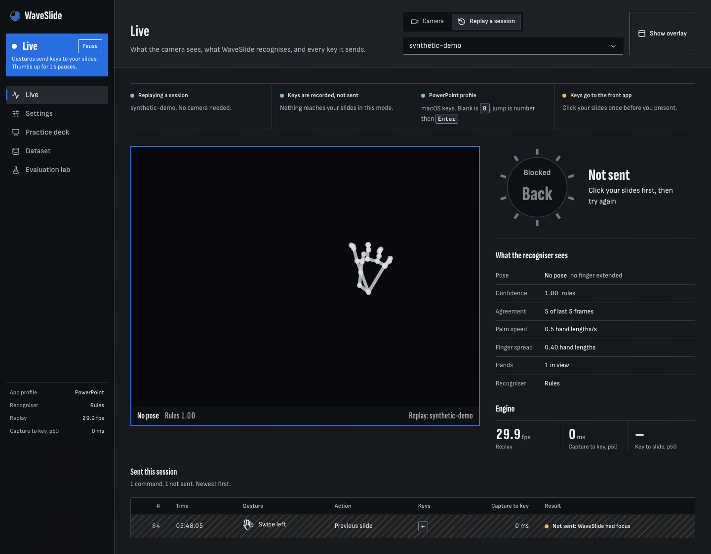

The always-on-top overlay shows the camera, the hand landmarks, the recognised pose and the hold ring:

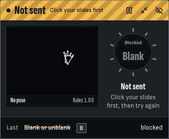

## What it does
- Swipe right or left to go to the next or previous slide.
- Hold 1 to 5 fingers still for 1 second to jump to that slide. A ring fills while you hold, so you can change your mind. With two-hand counting switched on, two hands add up to slides 6 to 10.
- Hold an open palm (fingers together) for 0.8 seconds to blank or unblank the screen. Hold a fist to start the slideshow, and thumbs-down to exit it.
- Start paused. A thumbs-up held for 1 second turns gesture control on and off, so talking with your hands does nothing.
- A settings screen to remap gestures, change sensitivity and timing, choose the camera, pick the target app profile, switch between rules and a trained classifier, and save, export, import or reset.
- A practice deck (`/practice`) to try gestures with no presentation app open.
- Tools for the report: a guided landmark recorder, a model trainer, and an evaluation lab with a rules-versus-classifier comparison.

## How it works
A Python engine owns the camera and the keyboard. It reads frames with OpenCV, finds 21 landmarks per hand with MediaPipe, smooths them, turns them into features that ignore distance and tilt, and decides the pose with rules (or a random forest). Swipes are found from palm motion. A state machine (paused, hold-to-confirm, stillness check, cooldown, re-arm) decides when a command may fire, and PyAutoGUI sends the keys for the chosen app profile. The engine streams its state over a WebSocket to a React UI that pywebview shows in two native windows. Everything after MediaPipe also runs on recorded landmark sessions, so tests and the offline demo need no webcam. Details: [docs/ARCHITECTURE.md](docs/ARCHITECTURE.md).

## Tech stack
| Part | Choice | Why |
|---|---|---|
| Engine | Python 3.12, FastAPI, uv | One process owns camera, recogniser and keys; FastAPI gives REST, WebSocket and a typed contract |
| Hand tracking | MediaPipe HandLandmarker | Ready-made 21-point hand model that runs on a laptop CPU |
| Video | OpenCV | Capture, mirroring, colour conversion, preview |
| Features and maths | NumPy | Angles, distances and filters on small arrays |
| Classifier | scikit-learn random forest | Small, fast, explainable; compared against the rules |
| Key presses | PyAutoGUI | Sends keys to the focused app on macOS and Windows |
| UI | React 19, Vite, TypeScript, CSS Modules | Typed screens that are easy to test |
| Desktop shell | pywebview | Native settings window and always-on-top overlay without a second runtime |
| Server state | TanStack Query | Caching and refresh for REST data |
| Charts | recharts (UI), matplotlib (report PNGs) | Evaluation lab in the app, images in the report |
| Storage | JSON and JSONL files in `data/` | One settings object and append-only sessions; no database needed |
| Tests | pytest, vitest, Playwright, MSW | Backend, components, browser journeys, mocked API |

## Quick start
Full instructions for Windows and macOS: [docs/SETUP.md](docs/SETUP.md).

```bash
npm run setup
npm run seed
npm start
```
`npm start` builds the UI and opens the settings window plus the overlay. With no webcam, use `npm run dev:replay` and open http://localhost:5173/practice. Keys are recorded, not pressed, in that mode.

## Screens
| Screen | Desktop | Phone width |
|---|---|---|
| Live (`/`) |  | 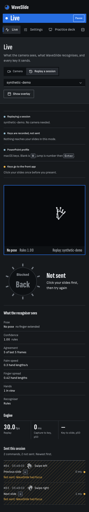 |
| Settings (`/settings`) | 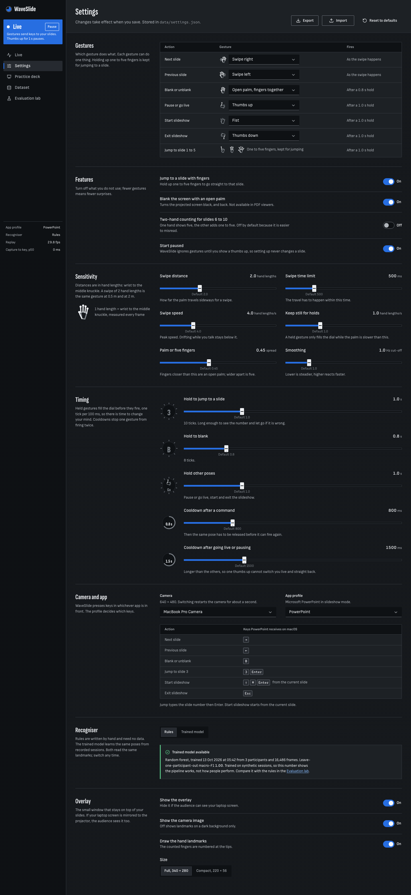 | 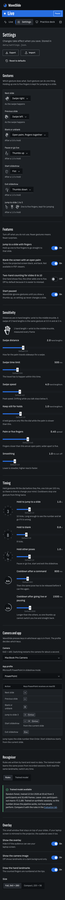 |
| Practice deck (`/practice`) | 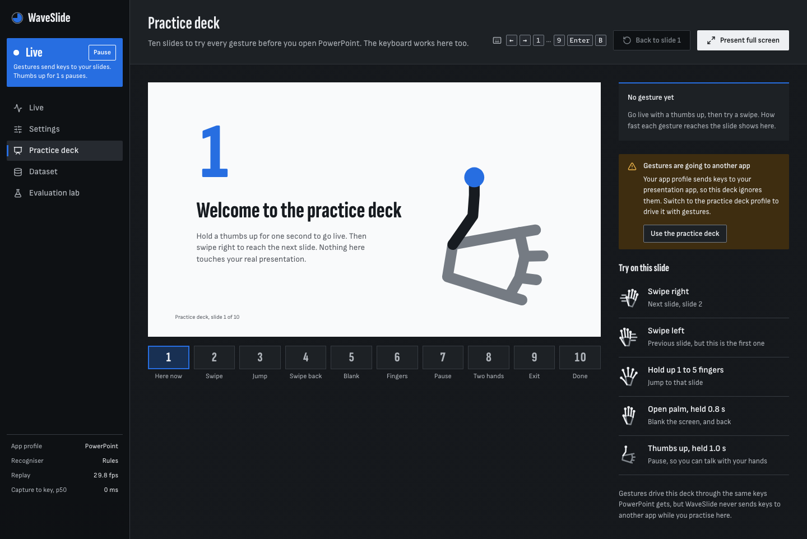 | 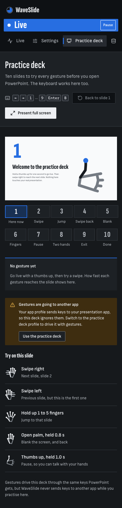 |
| Dataset (`/dataset`) | 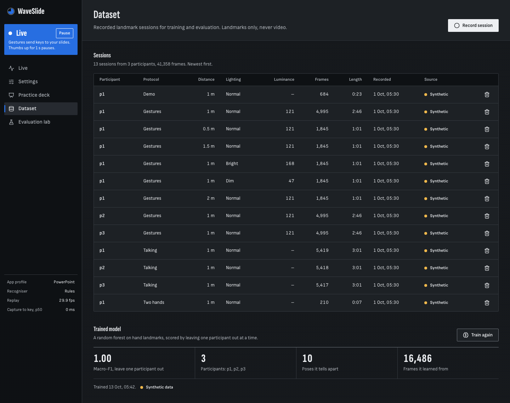 | 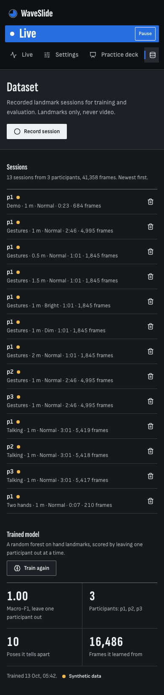 |
| Evaluation (`/evaluation`) | 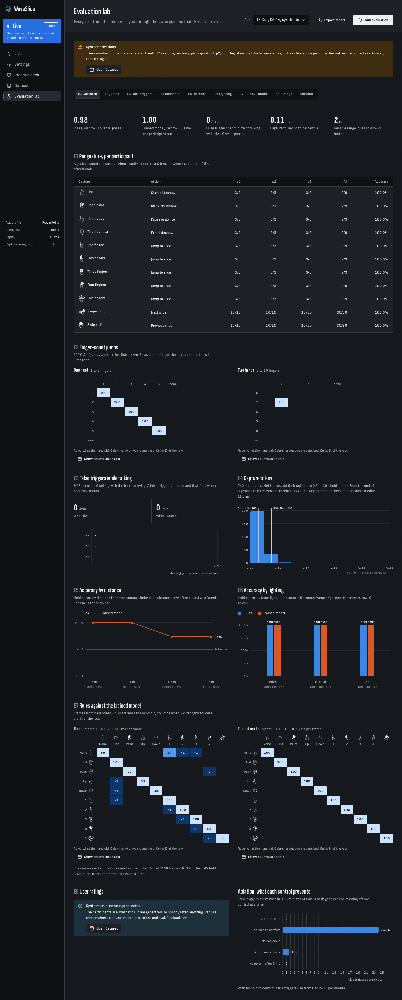 | 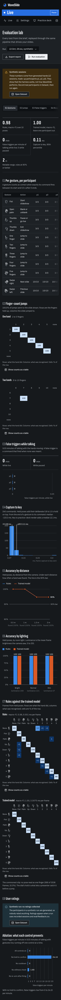 |

## Project structure
```
package.json        root scripts (setup, start, dev, test, ci, eval)
.env.example        engine settings; `npm run setup` copies it to .env
scripts/            setup.mjs and run-backend.mjs (cross-platform launchers)
backend/app/
  core/             the gesture pipeline: pure code, no FastAPI, no OpenCV
  engine/           engine thread, camera and replay sources, WebSocket hub
  keys/             app profiles (JSON) and key senders
  settings/ dataset/ ml/ evaluation/ platform/   one folder per feature
  contract/         pydantic models for REST, WebSocket and files
  desktop.py        the launcher that opens the two windows
backend/models/     MediaPipe hand model (committed, sha256 checked)
backend/tests/      pytest, with small synthetic sessions as fixtures
frontend/src/       app shell, api client, components, features per screen
frontend/e2e/       Playwright journeys, screenshots, visual baselines
eval/               run.py, PROTOCOL.md (user-study steps), feedback.csv
docs/               architecture, plan, design, evaluation, guides
data/               runtime files (gitignored): settings, sessions, models, eval
```

## Testing
```bash
npm test          # backend pytest + frontend vitest
npm run lint
npm run typecheck
npm run ci        # lint + typecheck + test (what GitHub Actions runs on macOS and Windows)
npm run e2e       # Playwright browser journeys
```
At the last check, `npm run test:api` passed 315 tests and the frontend vitest run passed 104 tests in 22 files. No test needs a webcam or presses real keys: they use replay sessions and a recording key sender. Tests that need hardware are marked `camera` or `keys` and are left out.

## Results
Every number in [docs/EVALUATION.md](docs/EVALUATION.md) comes from **synthetic** landmark sessions made by `npm run seed`. They show that the evaluation harness works. They are **not** a measurement of WaveSlide with real people, and must not be quoted as accuracy. The real participant study (protocol in `eval/PROTOCOL.md`) has not been run yet.

## Limitations and future work
- Not yet done: the manual hardware checks in [docs/PROFILE_CHECKS.md](docs/PROFILE_CHECKS.md) (real webcam, real key presses into PowerPoint, Google Slides and Acrobat, window focus behaviour) have no results recorded, and the participant study is unrun.
- One presenter: the largest hand wins. Presenter lock is future work.
- Thumb position makes COUNT_4 versus COUNT_5 and COUNT_5 versus OPEN_PALM the likeliest confusions.
- Keys go to the focused window, so the presentation must have focus. On macOS the terminal needs Camera and Accessibility permission.
- Blank screen does not exist in most PDF viewers, and PDF jump steps from `Home`.
- macOS support is Apple Silicon only (MediaPipe wheel). Windows needs the Edge WebView2 runtime.
- Future: presenter lock, voice commands, custom recorded gestures, longer range.

## Documentation
[Architecture](docs/ARCHITECTURE.md) · [Setup](docs/SETUP.md) · [Demo script](docs/DEMO_SCRIPT.md) · [Viva preparation](docs/VIVA.md) · [Report notes](docs/REPORT_NOTES.md) · [Evaluation](docs/EVALUATION.md) · [Hardware checks](docs/PROFILE_CHECKS.md) · [Plan](docs/PLAN.md)
