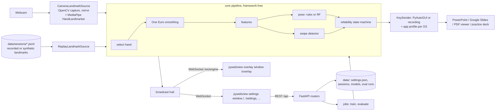

# WaveSlide: Architecture

## Summary
WaveSlide is a local desktop app that turns hand gestures in front of an ordinary webcam into slide-control key presses for PowerPoint, Google Slides and PDF viewers. A Python **engine** (FastAPI + uv) owns the camera and the keyboard: it reads frames with OpenCV, finds 21 hand landmarks per hand with MediaPipe HandLandmarker, smooths them with a One Euro filter, turns them into scale- and rotation-invariant features, classifies a **pose** (rules by default, or a trained scikit-learn random forest), detects **swipes** from palm motion, and passes every candidate command through a **reliability state machine** (activation pause, hold-to-confirm with a progress ring, stillness check, cooldown and re-arm) before PyAutoGUI sends the keys defined by the active app profile. The engine streams its state over a WebSocket to a React + Vite + TypeScript UI that pywebview shows in two native windows: a small always-on-top **overlay** (preview, landmarks, pose, hold ring, active/paused) and a **settings window** (live status, remapping, sensitivity, timing, camera, profile, practice deck, dataset recorder, evaluation lab). Everything after MediaPipe consumes recorded **landmark sessions** just as well as live frames, so the recogniser is tested, demonstrated and evaluated without a webcam. The interesting core is that real-time pipeline plus a measured comparison of rules against the classifier, with an ablation showing what each reliability control buys.

## Components

| Component | Responsibility | Tech |
|---|---|---|
| `backend/app/desktop.py` | One-command launcher: starts uvicorn on 127.0.0.1:8765 in a thread, then opens the settings window and the overlay window on the main thread (pywebview requires it) | pywebview 6 |
| `backend/app/engine/` | Engine thread loop, landmark sources (camera, replay), MediaPipe wrapper, broadcast hub (latest frame per client, events never dropped), MJPEG preview, latency log | OpenCV 5, MediaPipe 1.1 Tasks API |
| `backend/app/core/` | The interesting core, pure functions and small classes with explicit timestamps: hand selection, One Euro filter, features, pose rules, swipe detector, two-hand counting, intent mapping, reliability state machine | Python, NumPy |
| `backend/app/keys/` | App profiles (JSON per app, per OS), key sequences per action, focus guard, `PyAutoGuiSender` and `RecordingSender` (tests, replay, dry run) | PyAutoGUI |
| `backend/app/platform/` | macOS Camera and Accessibility checks (AVFoundation, `CGPreflightPostEventAccess`); camera names | pyobjc (macOS only), cv2-enumerate-cameras |
| `backend/app/settings/`, `dataset/`, `ml/`, `evaluation/` | Versioned JSON settings; guided recorder and session store; feature-vector training with leave-one-participant-out validation; replay-based evaluation harness and charts | pydantic, scikit-learn 1.9, matplotlib |
| `frontend/src/features/*` | overlay, live, settings, practice, dataset, evaluation screens | React 19, React Router, TanStack Query, CSS Modules + tokens, recharts |
| `frontend/src/api/engineSocket.ts` | One WebSocket client with reconnect; `useEngineFrame()` via `useSyncExternalStore`; events invalidate TanStack Query caches | browser WebSocket |
| `eval/run.py` | CLI for the full evaluation; writes `docs/EVALUATION.md` and `docs/eval/*.png` | backend env |

## Data model
No database. Everything is a small file under `WAVESLIDE_DATA_DIR` (default `data/`), validated by pydantic models that carry `schema_version`; `settings/store.py` has a `migrate()` step per version.
| Entity | Key fields | Relations | Notes |
|---|---|---|---|
| Settings (`settings.json`) | `mappings {next, previous, blank_toggle, toggle_active, start_show, exit_show -> gesture}`, `features {finger_jump, blank, two_hand}`, `sensitivity {swipe_min_travel, swipe_max_ms, swipe_min_speed, palm_spread_max, still_max_speed, smoothing}`, `timing {hold_count_ms, hold_palm_ms, hold_pose_ms, cooldown_ms, activation_cooldown_ms}`, `camera {index, width, height}`, `profile_id`, `recogniser rules|ml`, `overlay {visible, compact, show_preview, show_landmarks}`, `start_paused` | `profile_id` -> AppProfile | Singleton. Saved on every valid PUT; export/import as a file |
| AppProfile (`backend/app/keys/profiles/*.json`) | `id`, `name`, `keys {darwin, win32} -> {action -> key sequence}`, `jump {strategy: type_number | step_from_home}`, `unsupported[]` | | Read-only data, so a student can fix a shortcut without code |
| Session (`sessions/<id>.jsonl`) | header: `id`, `kind gestures|talking|two_hand`, `source recorded|synthetic`, `participant`, `distance_m`, `lighting bright|normal|dim`, `luminance_mean`, `fps`, `labels [{start, end, gesture}]`; then one line per frame: `t`, `hands [{handedness, score, landmarks[21][3]}]` | labels refer to gestures | **Landmarks only, never pixels** (privacy) |
| PoseModel (`models/pose_rf.joblib` + `model_card.json`) | `trained_at`, `classes`, `feature_version`, `n_frames`, `participants`, `lopo_macro_f1`, `sklearn_version` | trained from Sessions | Loaded only if `feature_version` matches |
| EvaluationRun (`eval/<run_id>/report.json`) | `id`, `created_at`, `dataset {sources, sessions}`, `sections E1-E8 + ablation`, `charts[]` | reads Sessions, PoseModel | `synthetic` flag shown on every number from synthetic data |
| Job (memory) | `id`, `kind train|evaluate`, `status`, `progress`, `result_id`, `error` | -> PoseModel / EvaluationRun | One job at a time |
| CommandLog (memory ring of 200 + `logs/commands-<date>.jsonl`) | `id`, `t`, `action`, `gesture`, `slide?`, `keys`, `pipeline_ms`, `dry_run`, `blocked_reason?`, `ack_ms?` | | Feeds the Live screen and live latency (E4) |

## API surface
Source of truth: `backend/openapi.json` (generated). `export_openapi.py` also adds the WebSocket message models (`EngineFrame`, `EngineEvent`, `ClientMessage`) to `components.schemas`, so `frontend/src/api/schema.d.ts` types the socket too.
| Method | Path | Request | Response | Errors |
|---|---|---|---|---|
| GET | `/api/health` | | `{status, version, source camera|replay, permissions {camera, keyboard}, model_loaded}` | |
| GET | `/api/engine` | | `EngineSnapshot {active, state, source, recogniser, fps, pipeline_ms_p50, profile_id, last_command?}` | |
| POST | `/api/engine/active` | `{active: bool}` | `EngineSnapshot` | |
| POST | `/api/engine/source` | `{kind: camera|replay, session_id?, loop?}` | `EngineSnapshot` | 404 `SESSION_NOT_FOUND`, 503 `CAMERA_UNAVAILABLE` |
| POST | `/api/overlay` | `{mode: full|compact|hidden}` | `{mode}` | |
| WS | `/ws/engine` | client: `hello {role}`, `focus {has_focus, route}`, `deck_ack {command_id, t}` | server: `frame` (≤30 Hz: hands, pose, confidence, hold {action, label, progress}, active, cooldown_ms, fps), `event` (`command`, `hold_cancelled`, `activation_changed`, `warning {code}`, `settings_changed`, `recording_prompt`, `job_progress`) | close 1008 on a foreign `Origin` |
| GET | `/api/preview.mjpg` | | `multipart/x-mixed-replace` JPEG, 320 px, mirrored | 409 `NO_CAMERA_IN_REPLAY` |
| GET | `/api/settings` | | `Settings` | |
| PUT | `/api/settings` | `Settings` | `Settings` | 422 `VALIDATION_ERROR`, 409 `MAPPING_CONFLICT`, 422 `ACTIVATION_MUST_BE_HELD_POSE`, 409 `NO_MODEL` |
| POST | `/api/settings/reset` | | `Settings` (defaults) | |
| GET / POST | `/api/settings/export`, `/api/settings/import` | `-` / `Settings` file | file / `Settings` | 422 `VALIDATION_ERROR` |
| GET | `/api/profiles` | | `AppProfile[]` (keys resolved for this OS) | |
| GET | `/api/cameras` | | `[{index, name}]` | |
| GET | `/api/sessions` | `?kind&source` | `SessionSummary[]` | |
| GET / DELETE | `/api/sessions/{id}` | | `SessionDetail` / 204 | 404 `SESSION_NOT_FOUND` |
| POST | `/api/recordings` | `{protocol: gestures|talking|two_hand, participant, distance_m, lighting}` | `RecordingStatus` (prompts follow as `recording_prompt` events) | 409 `CAMERA_REQUIRED`, 409 `RECORDING_IN_PROGRESS` |
| POST | `/api/recordings/current/stop` | | `SessionSummary` | 404 `NO_RECORDING` |
| GET | `/api/model` | | `ModelCard` | 404 `NO_MODEL` |
| POST | `/api/model/train` | `{sources?: [recorded, synthetic]}` | `Job` (202) | 422 `NOT_ENOUGH_DATA`, 409 `JOB_RUNNING` |
| POST | `/api/evaluations` | `{sources?, include_ml?}` | `Job` (202) | 422 `NOT_ENOUGH_DATA`, 409 `JOB_RUNNING` |
| GET | `/api/evaluations`, `/api/evaluations/{id}` | | `EvaluationSummary[]`, `EvaluationReport` | 404 `EVALUATION_NOT_FOUND` |
| GET | `/api/jobs/{id}` | | `Job` | 404 `JOB_NOT_FOUND` |

Error shape: `{ "error": { "code": "STRING_CODE", "message": "Human readable", "details": {} } }`

## The interesting core
**1. From pixels to landmarks.** Each frame is captured at 640x480, mirrored so that "right" means the presenter's right, converted BGR to RGB and given to MediaPipe HandLandmarker in VIDEO mode (`num_hands=2`), which returns 21 (x, y, z) points per hand plus left/right handedness. Everything below sees only these points, which is why a recorded session (the same points saved as JSON lines) can replace the camera.

**2. Choose and steady the hand.** The hand with the largest landmark bounding box is treated as the presenter's (closest to the camera); two-hand mode keeps the two largest. Each coordinate goes through a One Euro filter: an exponential moving average whose cut-off rises with speed, so a still hand stops jittering while a fast swipe is not delayed.

**3. Features that ignore distance and tilt.** Scale `s` = distance from wrist (0) to middle-finger knuckle (9). Points are re-centred on the wrist, divided by `s`, rotated so the wrist-to-knuckle line points up, and left hands are mirrored to look like right hands. A finger is *extended* when the angle at its middle joint is nearly straight (under 35 degrees of bend) and its tip is farther from the wrist than its middle joint; the thumb uses its IP-joint angle and its distance from the index knuckle. *Spread* = mean gap between neighbouring fingertips divided by `s`. *Thumb direction* is the thumb vector's angle in the un-rotated image.

**4. Pose rules (first match wins).** `THUMBS_UP` / `THUMBS_DOWN`: only the thumb extended, pointing within 45 degrees of up / down. `FIST`: nothing extended. `OPEN_PALM`: all five extended **and fingers together** (spread ≤ 0.45, a "stop" sign). `COUNT_N`: N fingers extended (five only when spread > 0.45, a "high five"). Otherwise `NONE`. A pose becomes *stable* only when 4 of the last 5 frames agree. The ML recogniser replaces only this step: a random forest on the same normalised 42 coordinates plus angles and spread, so the comparison isolates the classifier.

**5. Swipes.** The palm centre (mean of wrist and four knuckles) is kept for the last 0.5 s in units of `s`. A swipe fires when horizontal travel ≥ 2.0 `s` within ≤ 500 ms, vertical drift ≤ 0.5 × horizontal, and peak speed ≥ 4 `s`/s. Measuring in hand lengths means the same physical swipe counts at 0.5 m and at 2 m.

**6. Reliability state machine.** States `PAUSED -> ACTIVE <-> HOLDING -> COOLDOWN -> ACTIVE`. In `PAUSED` only the activation pose is watched. A static intent (count, palm, thumbs, fist) enters `HOLDING` only if the hand is still (palm speed < 1.0 `s`/s); the overlay ring fills as `elapsed / hold_time`; a pose change lasting over 150 ms or movement cancels it (`hold_cancelled`). A full ring fires the command; swipes fire at once. `COOLDOWN` ignores all intents for 800 ms (1500 ms after activation toggles), then the **re-arm rule** requires the firing pose to be released before it can fire again, so a palm held for five seconds blanks once. Commands then pass the **focus guard** (if a WaveSlide window other than the practice deck has focus, the keys are not sent and a warning is shown) and the profile's key sequence (for example PowerPoint jump to 3 = `3`, `Enter`; a PDF viewer = `Home`, then `Right` twice).

**7. Measured, not claimed.** Every command logs `pipeline_ms` (frame capture to key sent). The evaluation harness replays labelled sessions through the exact pipeline and reports E1 per-gesture accuracy by participant, E2 finger-count jump confusion (1-5, 6-10), E3 false triggers per minute while talking (active and paused), E4 response time (pipeline p50/p95, gesture-end to command, key to practice-deck render), E5 accuracy and detection rate by distance, E6 by lighting (with measured frame luminance), E7 rules against random forest with leave-one-participant-out confusion matrices and macro-F1, E8 user ratings, plus an **ablation** turning off hold, stillness, cooldown and re-arm one at a time to show the false triggers each one prevents. Cost per frame beyond MediaPipe is O(1) (fixed 21 points, 0.5 s buffer).

**Defaults (BRIEF §13), all editable in Settings:** activation `THUMBS_UP` held 1.0 s (the app starts paused); next/previous = swipe right/left; blank = `OPEN_PALM` held 0.8 s; jump = `COUNT_1..5` held 1.0 s; start slideshow (from the current slide, so a repeat is harmless) = `FIST` held 1.0 s; exit = `THUMBS_DOWN` held 1.0 s; cooldown 800 ms; two-hand counting off; recogniser rules; profile PowerPoint; camera 0 at 640x480/30 fps; detection confidence 0.6.

## Key decisions
| # | Decision | Alternative rejected | Why |
|---|---|---|---|
| 1 | Engine in Python owns camera, recogniser and keyboard; UI is a view over a WebSocket | Recognise in the browser with MediaPipe JS | The browser cannot send keys to PowerPoint; one process keeps timing and latency measurable |
| 2 | WebSocket for state | Server-Sent Events | Two-way: windows send `focus` (for the focus guard) and `deck_ack` (latency); the server pushes ~30 frames/s |
| 3 | pywebview with two windows (overlay `on_top`, frameless, `focus=False`) | Electron or Tauri; Tkinter/PyQt from the brief | Keeps the factory React UI with no second runtime; one `npm start` |
| 4 | Landmark sources as a port (camera or replay) | Testing with recorded video | Landmark JSON is small, private and exactly reproducible; all of `core/` runs in CI with no webcam |
| 5 | Measure gestures in hand lengths (`s`) | Pixel thresholds | Same thresholds work at 0.5-2 m; this is what E5 tests |
| 6 | `OPEN_PALM` (fingers together) vs `COUNT_5` (spread) separated by a spread threshold | Separate modes, or dropping slide 5 | Resolves the palm/five collision with one explainable feature; the confusion matrix shows how well it works |
| 7 | Hold requires stillness; re-arm after release | Hold timer only | Separates swipes from holds and stops repeated blanking; proven by the ablation |
| 8 | Rules drive the app; random forest is compared and switchable | Classifier only, or a neural network | Rules need no data and are explainable line by line; RF is small, fast, shows feature importances |
| 9 | Leave-one-participant-out validation | Random frame split | Neighbouring frames are near-identical, so a random split leaks and inflates accuracy |
| 10 | JSON files, no database | SQLite + migrations | One settings object and append-only sessions; files are easy to inspect, export and submit |
| 11 | Start slideshow uses "from current slide" | "From beginning" | Re-triggering mid-show does not jump back to slide 1 |
| 12 | Bind 127.0.0.1, check WebSocket `Origin`, CORS for the Vite origin only | Open local server | A web page in the user's browser must not read landmarks or trigger keys |

## Known limitations (say these in the viva)
- One presenter: the largest hand wins, so someone standing nearer the camera takes over (presenter lock is future work).
- Reliable range depends on the webcam; E5 reports where accuracy drops (expected around 2 m at 640x480).
- Thumb position makes `COUNT_4`/`COUNT_5` and `COUNT_5`/`OPEN_PALM` the most confused pairs; the hold ring lets the presenter correct before the jump.
- Keys go to whichever window has focus; the presentation must be focused, and on macOS the terminal or app running WaveSlide needs Accessibility and Camera permission.
- Shortcuts differ by app version: blank screen is not available in most PDF viewers, and PDF jump-to-slide steps through pages from `Home`.
- MediaPipe 1.1 ships macOS wheels for Apple Silicon only; Intel Macs are not supported. Windows needs the Edge WebView2 runtime (preinstalled on Windows 10/11).
- The 0.5 s response target applies from gesture *completion*: swipes fire mid-motion, but held poses add their deliberate 0.8-1.0 s hold by design (that hold is the protection against misreads).
- Response time is measured from frame capture; camera exposure and buffering (about 30-60 ms) are outside that number and are estimated once with a phone slow-motion video.
- Synthetic sessions exist for tests and the seeded demo only; reported results come from recorded participants.

## Out of scope
- Mobile apps, voice commands, laser pointer, drawing on slides, depth cameras or wearables.
- Multiple presenters or ignoring audience hands; long-range classroom use.
- User-recorded custom gestures (the classifier is trained on the fixed pose set).
- Linux, installers or code signing (run from source with one command).
- Any network service: no upload, no telemetry, no video saved.
