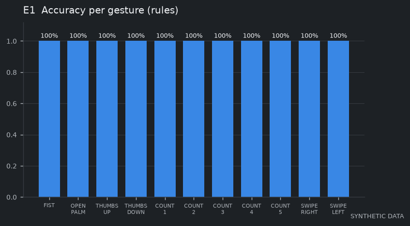
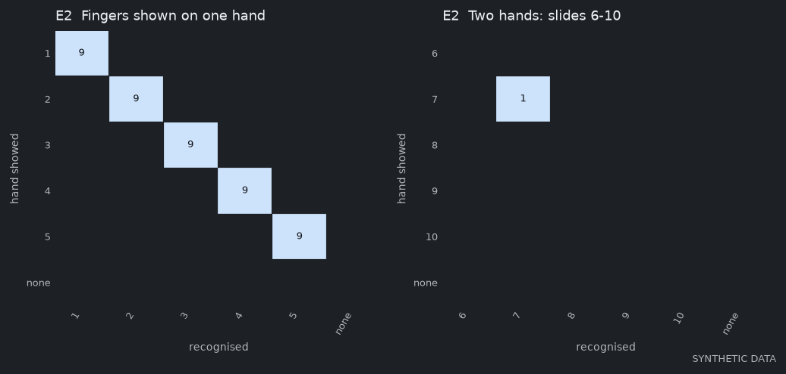
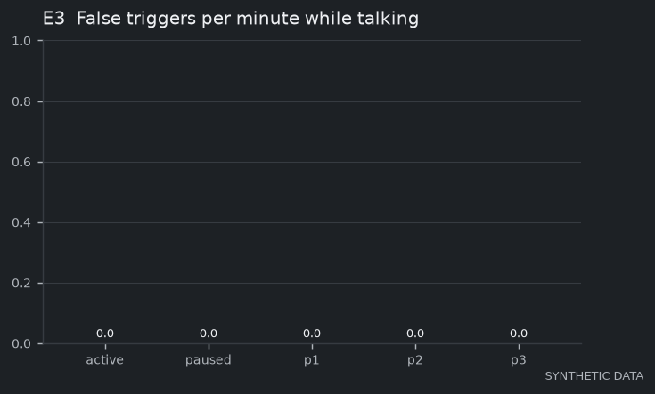
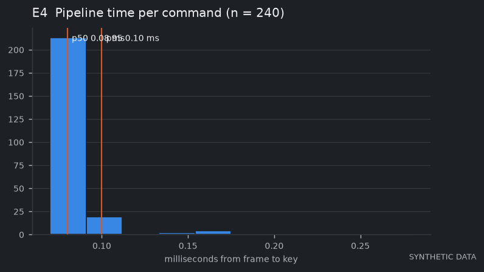
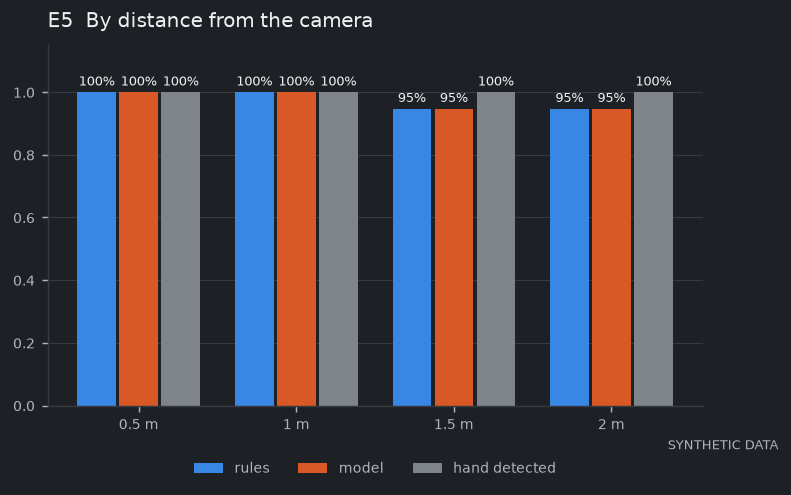
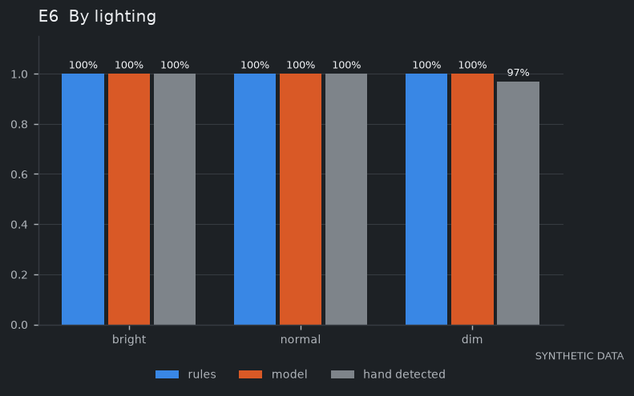
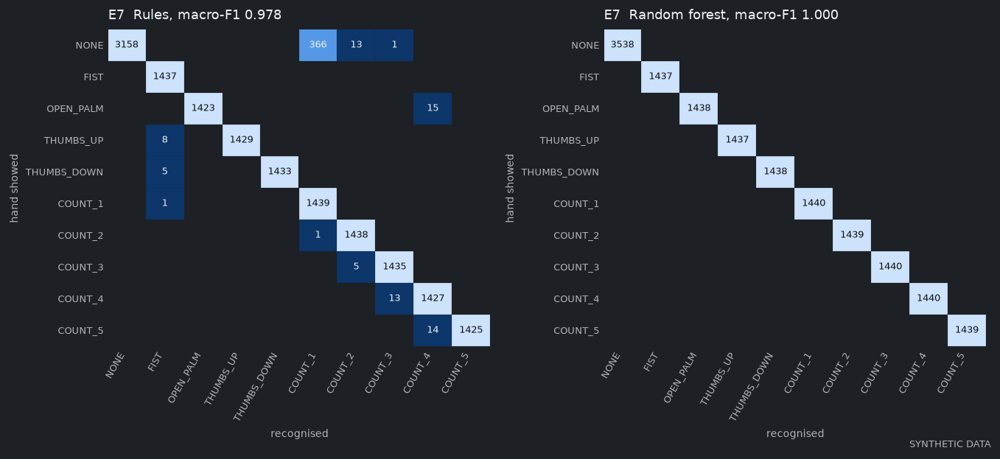
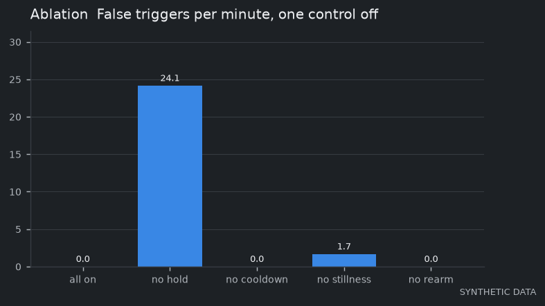

# WaveSlide: Evaluation results

Run `run-20261012-192739` on 2026-10-12. Sources: synthetic. 12 sessions, participants p1, p2, p3. Generated by `npm run eval`; do not edit by hand.

> **SYNTHETIC DATA.** These sessions are generated landmarks (`npm run seed`), not people. They prove the harness works end to end and are not a measurement of WaveSlide. Real numbers come from `eval/PROTOCOL.md` recordings (`npm run eval` without `--sources synthetic`).

## E1  Per-gesture accuracy by participant (SYNTHETIC)

_Computed from synthetic sessions._

| Gesture | Action | p1 | p2 | p3 | All |
|---|---|---|---|---|---|
| FIST | start_show | 3/3 | 3/3 | 3/3 | 9/9 (100.0%) |
| OPEN_PALM | blank_toggle | 3/3 | 3/3 | 3/3 | 9/9 (100.0%) |
| THUMBS_UP | toggle_active | 3/3 | 3/3 | 3/3 | 9/9 (100.0%) |
| THUMBS_DOWN | exit_show | 3/3 | 3/3 | 3/3 | 9/9 (100.0%) |
| COUNT_1 | jump | 3/3 | 3/3 | 3/3 | 9/9 (100.0%) |
| COUNT_2 | jump | 3/3 | 3/3 | 3/3 | 9/9 (100.0%) |
| COUNT_3 | jump | 3/3 | 3/3 | 3/3 | 9/9 (100.0%) |
| COUNT_4 | jump | 3/3 | 3/3 | 3/3 | 9/9 (100.0%) |
| COUNT_5 | jump | 3/3 | 3/3 | 3/3 | 9/9 (100.0%) |
| SWIPE_RIGHT | next | 10/10 | 10/10 | 10/10 | 30/30 (100.0%) |
| SWIPE_LEFT | previous | 10/10 | 10/10 | 10/10 | 30/30 (100.0%) |

A segment is correct when exactly the mapped command fires from its start to 0.5 s after its end.

## E2  Finger-count jumps (1-5 one hand, 6-10 two hands) (SYNTHETIC)

_Computed from synthetic sessions._

Accuracy 100.0%.

One hand:

| shown \ recognised | 1 | 2 | 3 | 4 | 5 | none |
|---|---|---|---|---|---|---|
| 1 | 9 | 0 | 0 | 0 | 0 | 0 |
| 2 | 0 | 9 | 0 | 0 | 0 | 0 |
| 3 | 0 | 0 | 9 | 0 | 0 | 0 |
| 4 | 0 | 0 | 0 | 9 | 0 | 0 |
| 5 | 0 | 0 | 0 | 0 | 9 | 0 |
| none | 0 | 0 | 0 | 0 | 0 | 0 |

Two hands:

| shown \ recognised | 6 | 7 | 8 | 9 | 10 | none |
|---|---|---|---|---|---|---|
| 6 | 0 | 0 | 0 | 0 | 0 | 0 |
| 7 | 0 | 1 | 0 | 0 | 0 | 0 |
| 8 | 0 | 0 | 0 | 0 | 0 | 0 |
| 9 | 0 | 0 | 0 | 0 | 0 | 0 |
| 10 | 0 | 0 | 0 | 0 | 0 | 0 |
| none | 0 | 0 | 0 | 0 | 0 | 0 |

## E3  False triggers per minute while talking (SYNTHETIC)

_Computed from synthetic sessions._

9.03 minutes of talking. Active: **0.00/min**. Paused: **0.00/min**.

| Participant | Active per minute |
|---|---|
| p1 | 0.00 |
| p2 | 0.00 |
| p3 | 0.00 |

## E4  Response time (SYNTHETIC)

_Computed from synthetic sessions._

| Measure | Value |
|---|---|
| Commands measured | 240 |
| Pipeline p50 / p95 (frame handed over to key sent, after landmarks) | 0.08 ms / 0.10 ms |
| Swipe: end of motion to command, p50 (negative: fires before the arm stops) | -133 ms |
| Key to practice-deck render, p50 (live use) | n/a |

Camera exposure and MediaPipe time are outside this number (ARCHITECTURE.md, limitations).

## E5  Accuracy and detection rate by distance (SYNTHETIC)

_Computed from synthetic sessions._

| Condition | Rules | Random forest | Hand detected | Mean luminance |
|---|---|---|---|---|
| 0.5 m | 100.0% | 100.0% | 100.0% | 121 |
| 1 m | 100.0% | 100.0% | 100.0% | 121 |
| 1.5 m | 94.7% | 94.7% | 100.0% | 121 |
| 2 m | 94.7% | 94.7% | 100.0% | 121 |

## E6  Accuracy and detection rate by lighting (SYNTHETIC)

_Computed from synthetic sessions._

| Condition | Rules | Random forest | Hand detected | Mean luminance |
|---|---|---|---|---|
| bright | 100.0% | 100.0% | 100.0% | 168 |
| normal | 100.0% | 100.0% | 100.0% | 121 |
| dim | 100.0% | 100.0% | 97.0% | 47 |

## E7  Rules against random forest (leave-one-participant-out) (SYNTHETIC)

_Computed from synthetic sessions._

| Recogniser | Macro-F1 | Time per frame |
|---|---|---|
| Rules | 0.978 | 0.001 ms |
| Random forest | 1.000 | 3.353 ms |

Rules:

| shown \ recognised | NONE | FIST | OPEN_PALM | THUMBS_UP | THUMBS_DOWN | COUNT_1 | COUNT_2 | COUNT_3 | COUNT_4 | COUNT_5 |
|---|---|---|---|---|---|---|---|---|---|---|
| NONE | 3158 | 0 | 0 | 0 | 0 | 366 | 13 | 1 | 0 | 0 |
| FIST | 0 | 1437 | 0 | 0 | 0 | 0 | 0 | 0 | 0 | 0 |
| OPEN_PALM | 0 | 0 | 1423 | 0 | 0 | 0 | 0 | 0 | 15 | 0 |
| THUMBS_UP | 0 | 8 | 0 | 1429 | 0 | 0 | 0 | 0 | 0 | 0 |
| THUMBS_DOWN | 0 | 5 | 0 | 0 | 1433 | 0 | 0 | 0 | 0 | 0 |
| COUNT_1 | 0 | 1 | 0 | 0 | 0 | 1439 | 0 | 0 | 0 | 0 |
| COUNT_2 | 0 | 0 | 0 | 0 | 0 | 1 | 1438 | 0 | 0 | 0 |
| COUNT_3 | 0 | 0 | 0 | 0 | 0 | 0 | 5 | 1435 | 0 | 0 |
| COUNT_4 | 0 | 0 | 0 | 0 | 0 | 0 | 0 | 13 | 1427 | 0 |
| COUNT_5 | 0 | 0 | 0 | 0 | 0 | 0 | 0 | 0 | 14 | 1425 |

Random forest:

| shown \ recognised | NONE | FIST | OPEN_PALM | THUMBS_UP | THUMBS_DOWN | COUNT_1 | COUNT_2 | COUNT_3 | COUNT_4 | COUNT_5 |
|---|---|---|---|---|---|---|---|---|---|---|
| NONE | 3538 | 0 | 0 | 0 | 0 | 0 | 0 | 0 | 0 | 0 |
| FIST | 0 | 1437 | 0 | 0 | 0 | 0 | 0 | 0 | 0 | 0 |
| OPEN_PALM | 0 | 0 | 1438 | 0 | 0 | 0 | 0 | 0 | 0 | 0 |
| THUMBS_UP | 0 | 0 | 0 | 1437 | 0 | 0 | 0 | 0 | 0 | 0 |
| THUMBS_DOWN | 0 | 0 | 0 | 0 | 1438 | 0 | 0 | 0 | 0 | 0 |
| COUNT_1 | 0 | 0 | 0 | 0 | 0 | 1440 | 0 | 0 | 0 | 0 |
| COUNT_2 | 0 | 0 | 0 | 0 | 0 | 0 | 1439 | 0 | 0 | 0 |
| COUNT_3 | 0 | 0 | 0 | 0 | 0 | 0 | 0 | 1440 | 0 | 0 |
| COUNT_4 | 0 | 0 | 0 | 0 | 0 | 0 | 0 | 0 | 1440 | 0 |
| COUNT_5 | 0 | 0 | 0 | 0 | 0 | 0 | 0 | 0 | 0 | 1439 |

## E8  User ratings (SYNTHETIC)

_Not recorded: no ratings in eval/feedback.csv yet._

## Ablation  What each reliability control prevents (SYNTHETIC)

_Computed from synthetic sessions._

9.03 minutes of talking, engine active, one control off at a time.

| Control off | False triggers per minute |
|---|---|
| all on | 0.00 |
| no hold | 24.15 |
| no cooldown | 0.00 |
| no stillness | 1.66 |
| no rearm | 0.00 |

Hold and stillness stop false starts. Cooldown and re-arm stop repeats of a deliberate gesture, so on talking (no deliberate gestures) they have nothing to prevent and show no change.
